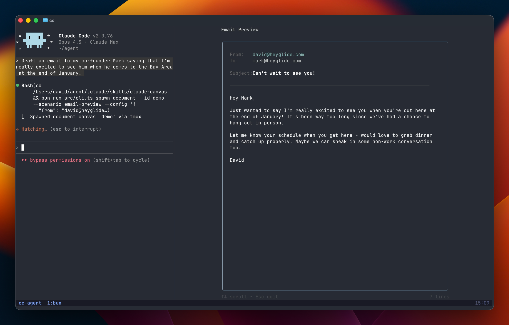

# opencode-canvas

Interactive terminal canvases for [OpenCode v2](https://opencode.ai/v2/docs): calendars,
Markdown documents, and flight comparison in tmux split panes.



## Compatibility

This fork uses the native `@opencode/plugin` API and is tested against **OpenCode 2.0.22**.
It requires Bun 1.3.2 or newer and tmux on a Unix-like host. OpenCode v1 is not supported
by this entrypoint.

The canvases run as React/Ink applications in tmux, using local Unix sockets for IPC.
Run OpenCode in the same tmux session and on the same host as the canvases. A background
server started outside tmux does not inherit the attached client's terminal environment;
use `opencode --standalone` inside tmux for that case. This port does not add an embedded
OpenCode TUI or web canvas.

## Install this fork from source

The published `@mailshieldai/opencode-canvas` release is the original v1 package; it does
not contain this port. Until a v2 release is published, use this checkout:

```bash
git clone https://github.com/TheViniAlmeida/opencode-canvas.git
cd opencode-canvas
git checkout feat/opencode-v2
bun install --frozen-lockfile
bun run build
```

Add the absolute path to the checkout directory to your
`opencode.jsonc` (project root or `~/.config/opencode/opencode.jsonc`):

```jsonc
{
  "plugins": ["/absolute/path/to/opencode-canvas"]
}
```

OpenCode 2.0.22 resolves local plugin directories through `server.js`, which loads
`dist/index.js`. Keep the package directory intact: it loads bundled commands and skills,
and starts the canvas CLI from `src/canvas/cli.ts`. The npm package includes those
assets, `server.js`, and the `run-canvas.sh` launcher. Tool permissions follow your OpenCode policy;
the plugin does not automatically grant itself access.

## Tools

| Tool | Purpose | Arguments |
| --- | --- | --- |
| `canvas_spawn` | Open a canvas in a new tmux split | `kind`, `config`, optional `scenario` |
| `canvas_update` | Send configuration and wait for acknowledgement | `id`, `config` |
| `canvas_selection` | Read the current document text selection | `id` |
| `canvas_close` | Close a canvas after its acknowledgement | `id` |

`config` is a JSON **string**. Use the returned `id` for subsequent calls.
OpenCode v2 tool results contain a `content` string with the JSON result.

```typescript
canvas_spawn({
  kind: 'document',
  scenario: 'edit',
  config: JSON.stringify({ title: 'Notes', content: '# Hello\n', readOnly: false }),
});

canvas_update({
  id: 'document-...',
  config: JSON.stringify({ title: 'Notes', content: '# Updated\n' }),
});

canvas_selection({ id: 'document-...' });
canvas_close({ id: 'document-...' });
```

| Canvas | Scenarios |
| --- | --- |
| `calendar` | `display`, `meeting-picker` |
| `document` | `display`, `edit`, `email-preview` |
| `flight` | `booking` |

The plugin registers the `canvas`, `calendar`, `document`, and `flight` skills through
OpenCode v2's skill registry. It also provides `/hello`, `/explain`, `/quick-review`,
and `/format-check`. These commands submit their templates with your current agent
and model and preserve prompt attachments and delivery mode. The v1 example metadata
for a fixed model, agent override, and background subtask has been removed: v2's
command API does not expose those fields.

## Development

```bash
bun install --frozen-lockfile
bun test
bun run typecheck
bun run build
npm pack --dry-run
bun run test:tmux # requires tmux; creates a private test server
```

Type checking covers the plugin, its tests, and the canvas CLI/renderers. The legacy
`src/canvas/api` convenience API is not exported by the plugin and is outside this
port's type-check target. The repository's existing ESLint configuration requires
additional development packages that are not declared in the original manifest.

See the official [v1-to-v2 plugin migration guide](https://opencode.ai/v2/docs/build/plugins/migrate-v1)
for the registration API used by this port.

## License and credits

MIT — see [LICENSE](LICENSE).

Based on [claude-canvas](https://github.com/dvdsgl/claude-canvas) by David Siegel,
adapted for OpenCode by [MailShield AI](https://github.com/mailshieldai).
